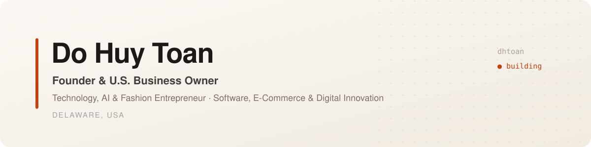

<picture>
  <source media="(prefers-color-scheme: dark)" srcset="assets/banner-dark.svg">
  
</picture>

  
  
  
  

### About

I build software and run online businesses in the United States, working where technology, e-commerce and fashion meet. Most of what I make starts as a tool I need myself: a Vietnamese keyboard that does not drop letters, a studio for producing media, assistants that take routine work off a small team.

- 🏢 Founder and owner of a U.S. small business, based in Delaware
- 🛍️ E-commerce and fashion retail online
- 🧠 Applied AI for small teams: content, operations, open-source maintenance
- 🇻🇳 Vietnamese, building for Vietnamese users and for global markets

### Featured work

<table>
<tr>
<td width="50%" valign="top">

**[Dokey](https://github.com/dhtoan/Dokey)** · C++17 · Swift · Win32 
A Vietnamese input method for macOS and Windows (Telex, VNI) that rebuilds the whole word on every keystroke, built so letters are not jumbled or lost in Chrome, Electron apps and AI chat tools. 

</td>
<td width="50%" valign="top">

**[Dokey for Android](https://github.com/dhtoan/Dokey-Android)** · Kotlin 
The Dokey keyboard on Android: Telex and VNI, Material You, 22 themes, a one-handed mode, and it works fully offline.

</td>
</tr>
<tr>
<td width="50%" valign="top">

**[AunoStudio](https://github.com/dhtoan/AunoStudio)** · TypeScript 
A self-hosted studio for editable video, motion graphics and social publishing, with workspace collaboration.

</td>
<td width="50%" valign="top">

**[AunoForge](https://github.com/dhtoan/AunoForge)** · JavaScript 
AI-assisted open-source maintenance you can verify: triage issues, reproduce bugs, review pull requests and prepare releases, with humans in control.

</td>
</tr>
<tr>
<td width="50%" valign="top">

**[aapanel-mcp](https://github.com/dhtoan/aapanel-mcp)** · TypeScript 
An MCP server that lets Claude manage an aaPanel server (websites, files, MySQL, cron, firewall), with permission levels.

</td>
<td width="50%" valign="top">

**[dhtoan.github.io](https://github.com/dhtoan/dhtoan.github.io)** · HTML · JS 
My personal site: about, papers and press kit.

</td>
</tr>
</table>

### Publication

> **Do Huy Toan** (2026). *Dokey: A Vietnamese Input Method That Rebuilds the Whole Word on Every Keystroke.* Working paper, Zenodo. [doi:10.5281/zenodo.23888629](https://doi.org/10.5281/zenodo.23888629)

### Tools I work with

  
  
  
  
  
  
  

Contact: <a href="https://dhtoan.github.io/">dhtoan.github.io</a>
